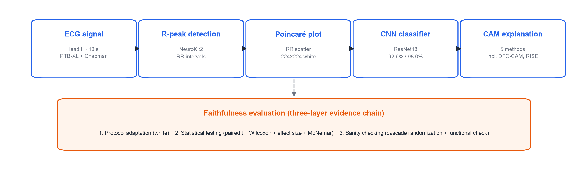

# Protocol Adaptation and Multi-Metric Evaluation of CAM Faithfulness on Poincaré-Plot ECG Images

This repository contains the experiment code and result files for the paper of the same title. The study uses atrial fibrillation detection from Poincaré-plot images as the testbed, compares five explanation methods (Grad-CAM, Grad-CAM++, Score-CAM, DFO-CAM, RISE), and evaluates their faithfulness with deletion/insertion curves and AD/AI/AG under different perturbation backgrounds, paired statistical tests, and cascaded-randomization checks.

Raw ECG recordings, trained model weights, and the manuscript are not included.



## Repository layout

```
code/data/             PTB-XL selection and download, Poincaré-plot generation (PTB-XL and Chapman)
code/training/         ResNet18 and ViT training, classification metrics
code/cam_faithfulness/ CAM comparison, faithfulness metrics, RISE, occlusion, timing
code/ablations/        background, threshold, epoch, dual-stream, initialization and RISE ablations
code/audit/            cascaded randomization and cross-validation
code/synthetic/        shape-vs-count control experiments
code/figures/          scripts that draw the paper figures
结果/                   result logs and per-image CSV files
图片/                   paper figures
third_party/           how to provide the external DFO-CAM implementation
```

Script names and output paths keep the numbering of the original experiment log. All scripts assume the repository root as the working directory, and they read and write the following directories:

- `data/` — datasets (not versioned)
- `模型/` — trained weights (not versioned)
- `结果/` — result files
- `图片/` — figures

## Environment

Python 3.10 or newer. Install the Python packages with:

```bash
pip install -r requirements.txt
```

`torch` and `torchvision` should be installed for the target platform (CPU or CUDA) according to the PyTorch instructions; the requirements file lists them without pinning a build. The GPU experiment (initialization ablation) was run on one NVIDIA RTX 3080 Ti. All other experiments run on CPU.

## Data

### PTB-XL

Download the PTB-XL 1.0.3 metadata file `ptbxl_database.csv` from PhysioNet and put it at `data/ptbxl/ptbxl_database.csv`:

```bash
mkdir -p data/ptbxl
curl -O https://physionet.org/files/ptb-xl/1.0.3/ptbxl_database.csv
mv ptbxl_database.csv data/ptbxl/
```

The scripts select one record per patient (300 normal, 300 atrial fibrillation), download the 100 Hz lead-II waveforms, and render 224×224 white-background Poincaré plots. Records with fewer than three detected RR intervals are skipped, which yields 597 images.

### Chapman-Shaoxing

The Chapman-Shaoxing records are downloaded from PhysioNet `ecg-arrhythmia` 1.0.0 by `code/data/第十七步_外部验证_筛选下载.py`. No manual step is required.

## Running the pipeline

### 1. PTB-XL data preparation

```bash
python code/data/第九步_准备PTBXL清单.py          # data/ptbxl/下载清单.txt
python code/data/第九步_下载PTBXL波形.py          # data/ptbxl/waveforms/{normal,af}
python code/data/第九步_生成PTBXL庞加莱图.py      # data/ptbxl/images/{normal,af}
```

### 2. Classification

```bash
python code/training/第九步_训练PTBXL分类.py       # 模型/resnet18_ptbxl.pth
python code/training/第九步_多次训练取平均.py       # 5 seeds, 结果/PTBXL多次平均.txt
python code/training/补算ROC指标.py                # ROC-AUC, sensitivity, specificity
python code/training/第十六步_ViT训练PTBXL分类.py   # ViT-B/16 baseline
```

The classification results in Table 1 are produced by the single-seed training (accuracy, weights), the five-seed run (mean ± SD), and the ROC script. The trained weights are needed by all explanation scripts.

### 3. Input-dependence checks

```bash
python code/cam_faithfulness/第十步_遮挡实验.py
python code/synthetic/第七步_形状vs数量实验.py
python code/synthetic/第七步_三组对照实验.py
python code/synthetic/第七步_固定点数量生成图.py
python code/synthetic/第七步_训练固定点数.py
```

### 4. CAM comparison and faithfulness metrics

Scripts that use DFO-CAM load `third_party/dfo-cam/dfo-cam.py`; see `third_party/README.md` for how to provide it.

```bash
python code/cam_faithfulness/第十一步_忠实性指标.py
python code/cam_faithfulness/第十一步_诊断底色影响.py
python code/cam_faithfulness/第十二步_DFOCAM对比.py
python code/cam_faithfulness/第十四步_大样本显著性检验.py
python code/cam_faithfulness/第十四步_RISE补跑.py
python code/cam_faithfulness/效率对比计时.py
```

The deletion/insertion protocol uses per-pixel ordering, 40 steps, and a single-image min-max normalization of the class logit. AD/AI/AG use the ground-truth class and a CAM threshold of τ = 0.5 unless a script states otherwise. White background is the adapted setting; the gray background is the original protocol for natural images.

### 5. Chapman-Shaoxing repeated experiment

```bash
python code/data/第十七步_外部验证_筛选下载.py
python code/data/第十七步_外部验证_生成庞加莱图.py
python code/training/第十七步_外部验证_训练分类.py
python code/cam_faithfulness/第十七步_外部验证_忠实性.py
python code/cam_faithfulness/第十七步补充_五方法忠实性.py
```

The Chapman model is trained from scratch on the Chapman images; it is not a transfer of the PTB-XL model.

### 6. Background and threshold analyses

```bash
python code/ablations/第十四步补充E_底图对照.py
python code/ablations/第十四步补充J_五方法四底图.py
python code/ablations/第十四步补充B_阈值消融.py
python code/ablations/第十四步补充F_阈值公平性扫描.py
python code/ablations/第十四步补充G_随机基线内容指标.py
```

These use the PTB-XL and Chapman models produced above.

### 7. Sanity checks

```bash
python code/audit/第十五步_SanityCheck.py
python code/audit/第十五步B_SanityCheck交叉验证.py
```

### 8. DFO-CAM ablations

```bash
python code/ablations/第十三步_DFOCAM初始化消融_GPU.py   # GPU
python code/ablations/第十四步补充C_轮数消融.py
python code/ablations/第十四步补充D_双流消融.py
python code/ablations/第十四步补充H_DFO非确定性.py
python code/ablations/第十四步补充I_概率校准.py
python code/ablations/第十四步补充K_RISE消融.py
```

### 9. Figures

The scripts below redraw the paper figures from the result files, mostly without rerunning the experiments:

```bash
python code/figures/画方法流程图.py
python code/figures/重画CAM热力图.py
python code/figures/重画统计图.py
python code/figures/重画交叉验证.py
python code/figures/重画消融图.py
python code/figures/画底图对照图.py
python code/figures/画指标分化图.py
python code/figures/错误分析可视化.py
python code/figures/画技术路线图_英文高清.py
```

## Script-to-paper map

| Paper item | Script | Main output |
| --- | --- | --- |
| Table 1, PTB-XL accuracy | `第九步_训练PTBXL分类.py`, `第九步_多次训练取平均.py` | `结果/PTBXL分类结果.txt`, `结果/PTBXL多次平均.txt` |
| Table 1, ROC-AUC | `补算ROC指标.py` | `结果/补算ROC指标结果.txt` |
| Table 1, Chapman accuracy | `第十七步_外部验证_训练分类.py` | `结果/第十七步_Chapman分类结果.txt` |
| Table 2, occlusion | `第十步_遮挡实验.py` | `结果/PTBXL遮挡实验结果.txt` |
| Shape vs. count | `第七步_形状vs数量实验.py`, `第七步_三组对照实验.py` | `结果/形状数量实验结果.txt`, `结果/三组对照结果.txt` |
| Faithfulness protocol and background diagnosis | `第十一步_忠实性指标.py`, `第十一步_诊断底色影响.py` | `结果/PTBXL忠实性指标结果.txt`, `结果/诊断_底色影响.txt` |
| Background adaptation | `第十四步补充E_底图对照.py`, `第十四步补充J_五方法四底图.py` | `结果/底图对照结果.txt`, `结果/五方法四底图.txt` |
| Multi-metric comparison | `第十二步_DFOCAM对比.py`, `第十四步_大样本显著性检验.py`, `第十四步_RISE补跑.py` | `结果/第十四步_*.csv`, `结果/第十四步_*.txt` |
| Threshold and retained-ratio alignment | `第十四步补充B_阈值消融.py`, `第十四步补充F_阈值公平性扫描.py` | `结果/阈值消融结果.txt`, `结果/阈值公平性扫描结果.txt` |
| Random baseline for content metrics | `第十四步补充G_随机基线内容指标.py` | `结果/随机基线内容指标.txt` |
| Chapman five-method comparison | `第十七步补充_五方法忠实性.py` | `结果/Chapman五方法忠实性.txt` |
| Cascaded randomization | `第十五步_SanityCheck.py`, `第十五步B_SanityCheck交叉验证.py` | `结果/第十五步_*.txt` |
| DFO-CAM initialization and robustness | `第十三步_DFOCAM初始化消融_GPU.py`, `第十四步补充C/D/H/I` | `结果/DFOCAM初始化消融结果.txt`, `结果/轮数消融结果.txt`, `结果/双流消融结果.txt`, `结果/DFO非确定性.txt`, `结果/概率校准.txt` |
| RISE configuration ablation | `第十四步补充K_RISE消融.py` | `结果/RISE消融.txt` |
| Efficiency | `效率对比计时.py` | `结果/效率对比计时结果.txt` |

## Notes

- Results are written to `结果/` and figures to `图片/`. The files already in those directories are the runs used in the paper.
- Class indices follow the alphabetical order of `torchvision.datasets.ImageFolder`, i.e. `af` = 0, `normal` = 1.
- The scripts use Chinese file and directory names from the original experiment record; run them from the repository root so that the relative paths resolve.
- Statistical tests use paired t-test, Wilcoxon signed-rank, Cohen's dz, bootstrap confidence intervals, and McNemar's test as indicated in each script. Bonferroni correction is applied within each family of comparisons.
